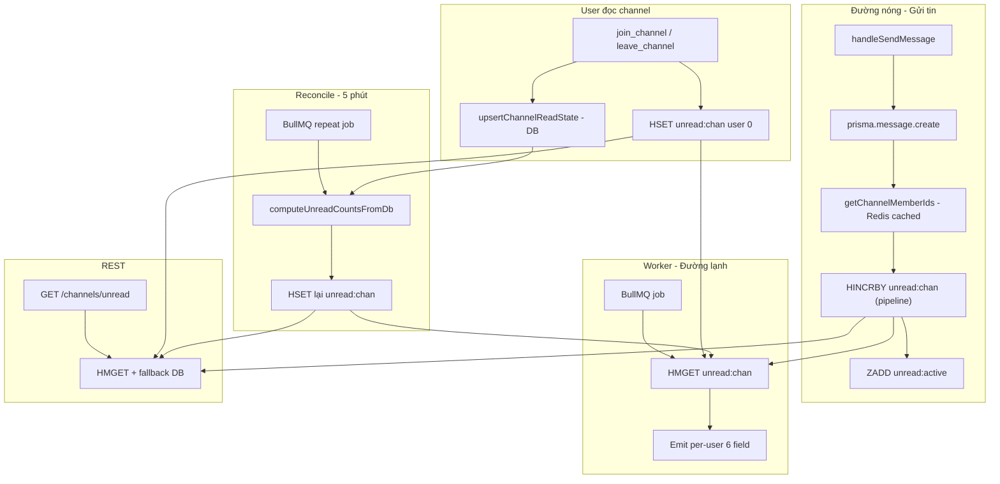

# Tổng quan: Tối ưu Unread Count

> 📍 **Mục tiêu tài liệu:** Hướng dẫn chuyển hệ thống unread count từ "FE tự cộng" sang "server là nguồn sự thật", dùng Redis làm store chính.
> 🎯 **Đọc theo thứ tự:** Phase 0 → Phase 6, mỗi phase độc lập, làm xong phase mới đi tiếp.

---

## 🎯 Bối cảnh

Frontend cần payload `channel_unread` đầy đủ:

```typescript
export type ChannelUnreadPayload = {
  channelId: string;
  workspaceId: string;
  type: ChannelType; // "DM" | "TEXT" | "VOICE"
  count: number; // server tính: total - last_read
  lastMessageId: string;
  senderId: string;
};
```

Server hiện chỉ gửi được 3/6 field, `count` là placeholder, `type` hardcode `''`.

---

## 💡 Vấn đề gốc: `count` là giá trị PER-USER

Mỗi user có `lastReadMessageId` riêng:

```
Channel 10 có 5 tin (id 101..105)
User A đã đọc tới 103 → count(A) = 2
User B đã đọc tới 105 → count(B) = 0
User C chưa đọc gì    → count(C) = 5
```

→ **Không gom được 1 payload chung cho cả room.** Phải emit riêng từng user.

Hệ quả: `count` phải do **server** tính (mỗi user một giá trị khác nhau), và FE phải **replace** chứ không cộng dồn.

---

## 📊 So sánh trước / sau

| | Hiện tại | Mục tiêu |
|---|---|---|
| Nguồn sự thật `count` | FE tự `+= 1` | **Redis Hash** (đồng bộ với DB) |
| Query DB trên đường nóng | 0 (nhưng thiếu count) | **0** |
| Query DB trên đường emit | 0 (thiếu count) | **0** (đọc `HMGET`) |
| Query DB của REST | **N+1** (≈22 query / 20 channel) | **1–2** |
| Tự lành khi mất event | ❌ Lệch vĩnh viễn | ✅ Server gửi lại đúng |
| Multi-tab / multi-device | ❌ Lệch nhau | ✅ Khớp |
| Payload | 3/6 field | **6/6 field** |
| DM badge | ❌ Chết | ✅ Hoạt động |
| Khớp REST ↔ socket | ❌ 2 công thức | ✅ 1 nguồn |

---

## 🗺️ Lộ trình

| Phase | Nội dung | Query DB đường nóng | Rủi ro | Thời gian |
|---|---|---|---|---|
| [0](./phase-00-overview.md) | Tổng quan, chốt hướng | — | — | 20 phút (đọc) |
| [1](./phase-01-server-authoritative-count.md) | Server tính `count` (cutoff grouping), payload đầy đủ | ~3/channel (emit) | Thấp | 1.5–2 giờ |
| [2](./phase-02-read-state-leave-channel.md) | Read state khi `leave_channel`, mở DM | 0 | Thấp | 1–1.5 giờ |
| [3](./phase-03-redis-unread-counter.md) | Chuyển count sang Redis Hash (`HINCRBY`) | **0** | Trung bình | 2–2.5 giờ |
| [4](./phase-04-rest-unread-from-redis.md) | REST đọc từ Redis | **0** | Thấp | 1–1.5 giờ |
| [5](./phase-05-reconcile-job.md) | Cron 5 phút tự sửa counter lệch | 0 | Thấp | 2–2.5 giờ |
| [6](./phase-06-testing-rollout.md) | Test matrix + checklist rollout | — | — | 1 giờ |

---

## 🏗️ Kiến trúc cuối cùng



### Cấu trúc dữ liệu Redis

| Key | Type | Mục đích |
|---|---|---|
| `chat:unread:{channelId}` | Hash | field = userId, value = số tin chưa đọc |
| `chat:unread:active` | ZSET | channelId → timestamp, để reconcile biết channel nào hot |
| `chat:channel:{channelId}:members` | Set | đã có sẵn (Phase 1) |
| `chat:channel:{channelId}:type` | String | đã có sẵn |
| `chat:channel:{channelId}:workspace` | String | đã có sẵn |

---

## 📐 Công thức count (chốt 1 công thức duy nhất)

```
count(user) = COUNT(
  messages
  WHERE channelId = :channelId
    AND id > lastReadMessageId(user)
    AND messageType != 'CONFIG'
)
```

Vì `id` là `BigInt @default(autoincrement())` → tăng đơn điệu nên `id > cutoff` ⇔ "sau tin cuối user đã đọc".

**Hiện tại 2 nơi dùng 2 công thức khác nhau** → phải thống nhất (Phase 1 sửa, Phase 4 áp dụng cho REST).

### Edge case

| Tình huống | Xử lý |
|---|---|
| User chưa có `channel_read_states` | cutoff = 0 → count = toàn bộ message |
| Message type `CONFIG` | Không tính vào unread |
| Message id không liên tục (rollback) | `HINCRBY` không quan tâm gap → OK |

---

## 🔑 Quyết định thiết kế then chốt

### 1. Increment ở WRITE path, không ở worker

| Vị trí | Worker retry | Kết quả |
|---|---|---|
| **Write path** (`handleSendMessage`) | Không liên quan | ✅ Tăng đúng 1 lần/message |
| Worker | Retry → `HINCRBY` lần 2 | ❌ Đếm thừa |

### 2. Redis Hash, không phải Set/String

| Lệnh | Hash | Set | String |
|---|---|---|---|
| `HINCRBY` | ✅ atomic O(1) | ❌ race | ❌ race |
| `HMGET` N field | ✅ 1 round trip | ❌ lọc sau | ❌ N lần |
| `HSET` reset 1 field | ✅ | ❌ | ❌ |

### 3. Số query không phụ thuộc số member (cutoff grouping)

```
User A: cutoff 103
User B: cutoff 103   ← gom
User C: cutoff 100
User D: cutoff 105
→ 3 distinct cutoff → 3 count query cho 4 user
```

Channel 5 hay 5000 member đều ~3 query.

### 4. Không tránh được N lần publish

```javascript
// node_modules/@socket.io/redis-adapter/dist/index.js
if (opts.rooms && opts.rooms.size === 1) {
  channel += opts.rooms.keys().next().value + "#";
}
this.pubClient.publish(channel, msg);
```

→ `io.to([room1..roomN])` vẫn publish N lần. Chấp nhận được (nhỏ hơn N query DB nhiều).

> Muốn 1 publish duy nhất → phải đổi FE sang delta + cộng dồn → quay lại vấn đề drift. **Không làm.**

---

## ⚠️ FE không cần sửa logic (chỉ sửa type)

```typescript
// client/src/store/unreadStore.ts
const { senderId: _senderId, ...rest } = payload;
next.set(payload.channelId, { unread: true, ...prev, ...rest });   // ← rest chứa count → ĐÈ
```

→ Đã đúng với mô hình server-authoritative. Chỉ cần sửa type:

```typescript
workspaceId: string | null   // DM không có workspace
```

---

## 📎 Liên kết tài liệu khác

| Tài liệu | Nội dung |
|---|---|
| [Phase 11 Load Balancer](../redis-implementation/phase-11-load-balancer.md) | Nginx sticky session, multi-instance |
| [Architecture Overview](../redis-implementation/phase-10-architecture-overview.md) | Tổng quan hệ thống Redis |
| `Document/redis-realtime-optimization.md` | Tối ưu realtime |
| `Document/redis-solution-theory.md` | Lý thuyết Redis |
