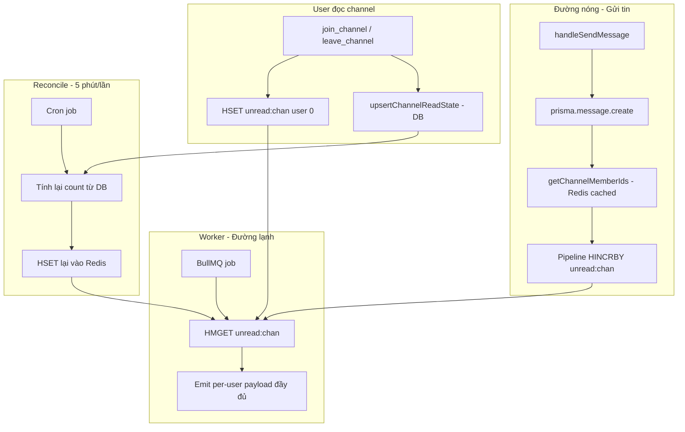

# Phase 0: Tổng quan - Unread Count Server-Authoritative

> ⏱️ **Thời gian:** 20 phút (đọc)
> 🎯 **Mục tiêu:** Hiểu vấn đề `count` unread, chốt hướng giải pháp, hiểu roadmap các phase sau
> 📍 **Vị trí code:** `src/queues/unread.worker.ts`, `src/socket/utils.ts`, `src/socket/socket.ts`, `src/services/redis.services.ts`, `src/services/channel.services.ts`

---

## 🎯 Vấn đề hiện tại

Frontend đang cần payload `channel_unread` đầy đủ:

```typescript
export type ChannelUnreadPayload = {
  channelId: string;
  workspaceId: string;
  type: ChannelType; // "DM" | "TEXT" | "VOICE"
  count: number; // server tính: total - last_read
  lastMessageId: string;
  senderId: string;
};
```

Nhưng server hiện chỉ gửi:

```typescript
// src/queues/unread.worker.ts
io.to(rooms).emit('channel_unread', {
  channelId,
  workspaceId: group.workspaceId,
  latestMessageId: group.latestMessageId,
  type: ''   // ← placeholder
})
```

| Trường FE cần | Server có | Ghi chú |
|---|---|---|
| `channelId` | ✅ | nhưng là `number`, FE kỳ vọng `string` |
| `workspaceId` | ✅ | nhưng DM phải là `null`, FE type đang ghi `string` |
| `type` | ❌ | đang hardcode `''` |
| `count` | ❌ | **thiếu hoàn toàn** — đây là phần cốt lõi |
| `lastMessageId` | ⚠️ | server gửi `latestMessageId` — tên khác |
| `senderId` | ❌ | thiếu |

---

## 📚 Lý thuyết tối thiểu

### 1. `count` là giá trị PER-USER, không phải PER-CHANNEL

Đây là điểm mấu chốt nhất.

Mỗi user có `lastReadMessageId` riêng trong bảng `channel_read_states`:

```
Channel 10 có 5 tin nhắn (id: 101, 102, 103, 104, 105)

User A đã đọc tới 103  → count(A) = 2  (104, 105)
User B đã đọc tới 105  → count(B) = 0  (đọc hết rồi)
User C chưa đọc gì    → count(C) = 5  (101..105)
```

→ **Không thể gom 1 payload chung cho cả room**, vì mỗi user một giá trị khác nhau.

Hệ quả trực tiếp: phải **emit riêng từng user**:

```typescript
io.to(Socket_Room.user(String(userId))).emit('channel_unread', { ... })
```

### 2. Vì sao `count` phải do SERVER tính (không cộng dồn ở FE)

Cách cũ (FE tự `count += 1`) là **client-side state** → 4 lỗi:

| Vấn đề | Giải thích |
|---|---|
| **Drift (lệch dần)** | Mất 1 event socket (mạng chập chờn, instance restart, tab bị kill) → FE đếm thiếu **vĩnh viễn**, không tự lành |
| **Trùng lặp (duplicate)** | Socket.IO reconnect hoặc aggregator flush lại batch → FE cộng 2 lần |
| **Nhiều tab / nhiều thiết bị** | Tab A đếm 3, tab B đếm 5 → lệch nhau |
| **Không khớp REST snapshot** | FE load `/channels/unread` (count = 10) rồi socket đến 1 event → cộng thành 11 |

Nguyên tắc: **đếm cái gì thì nguồn sự thật phải ở nơi biết chắc nhất.** Server biết chắc hơn client vì client có thể bỏ sót event.

"Replace" (`{ ...prev, ...payload }`) là **idempotent** → gửi lại 5 lần vẫn đúng.

### 3. FE hiện tại đã "replace" — không cộng dồn

```typescript
// client/src/store/unreadStore.ts
markUnread: (payload: ChannelUnreadPayload) => {
  ...
  const { senderId: _senderId, ...rest } = payload;
  const next = new Map(state.byChannelId);
  next.set(payload.channelId, { unread: true, ...prev, ...rest });  // ← rest chứa count → ĐÈ
  ...
}
```

→ **Đây đã đúng với mô hình server-authoritative.** Không cần sửa FE logic cộng dồn.

> ⚠️ Nếu sau này muốn dùng **delta** (server gửi "vừa thêm N tin") để gom 1 publish duy nhất → phải sửa FE thành `count: (prev?.count ?? 0) + payload.count`. Đánh đổi độ chính xác. **Không làm.**

### 4. Chi phí emit không tránh được

Adapter Redis chỉ gom được 1 channel khi `rooms.size === 1`:

```javascript
// node_modules/@socket.io/redis-adapter/dist/index.js
broadcast(packet, opts) {
  ...
  let channel = this.channel;
  if (opts.rooms && opts.rooms.size === 1) {
    channel += opts.rooms.keys().next().value + "#";
  }
  this.pubClient.publish(channel, msg);
}
```

→ `io.to([room1, room2, ...roomN])` vẫn publish **N lần**, mỗi lần 1 message nhỏ.
Rẻ hơn nhiều so với N query DB, nên **chấp nhận được**.

---

## 🔧 Công thức count — chốt 1 công thức duy nhất

Vì `id` trong bảng `messages` là `BigInt @default(autoincrement())` → tăng đơn điệu:

```
count(user) = COUNT(
  messages
  WHERE channelId = :channelId
    AND id > lastReadMessageId(user)
    AND messageType != 'CONFIG'
)
```

**Hiện tại có 2 công thức khác nhau → phải thống nhất:**

| Nơi | Công thức hiện tại | Vấn đề |
|---|---|---|
| REST `/channels/unread` | `createdAt > lastReadAt` | timestamp trùng ms → sai biên |
| Socket (đề xuất) | `id > lastReadMessageId` | chính xác hơn |

Nếu không thống nhất → FE thấy badge nhảy số giữa lúc refresh (REST) và lúc realtime (socket).

**Quyết định:** dùng `id > lastReadMessageId` cho **cả 2 nơi**.

### Edge case: user chưa có `channel_read_states`

→ `lastReadMessageId = 0` → count = toàn bộ message của channel.

### Edge case: message `CONFIG`

Message type `CONFIG` là message hệ thống (đổi setting/nickname) — **không phải tin nhắn**, không tính vào unread.

---

## 📊 Kiến trúc mục tiêu (tổng quan các phase)



---

## 🗺️ Roadmap các phase

| Phase | Nội dung | DB query trên đường nóng | Rủi ro |
|---|---|---|---|
| [Phase 1](./phase-01-server-authoritative-count.md) | Server tính `count` từ DB (cutoff grouping), emit per-user, payload đầy đủ | ~3/channel | Thấp || [Phase 2](./phase-02-read-state-leave-channel.md) | Fix read state khi `leave_channel`, bỏ skip DM | 0 | Thấp |
| [Phase 3](./phase-03-redis-unread-counter.md) | Chuyển count sang Redis Hash (`HINCRBY`), worker đọc `HMGET` | **0** | Trung bình |
| [Phase 4](./phase-04-rest-unread-from-redis.md) | REST `/channels/unread` đọc từ Redis (đồng bộ tuyệt đối với socket) | 0 | Thấp |
| [Phase 5](./phase-05-reconcile-job.md) | Cron job mỗi 5 phút tự sửa counter lệch | 3/channel / 5 phút | Thấp |
| [Phase 6](./phase-06-testing-rollout.md) | Test matrix + checklist rollout | — | — |

---

## ✅ Checkpoint Phase 0

- [ ] Đọc xong tài liệu này
- [ ] Hiểu vì sao `count` là per-user → phải emit per-user
- [ ] Hiểu vì sao server-authoritative > FE cộng dồn
- [ ] Chốt công thức: `id > lastReadMessageId`, loại `CONFIG`
- [ ] Nắm roadmap 6 phase

---

## 🔜 Phase tiếp theo

**[Phase 1: Server-authoritative count (cutoff grouping) →](./phase-01-server-authoritative-count.md)**

Phase 1 sửa payload + cách tính `count`, giữ DB là nguồn sự thật. Ít rủi ro, làm trước để hệ thống chạy đúng.
