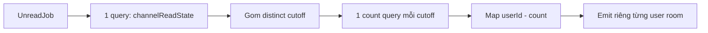

# Phase 1: Server-Authoritative Count (Cutoff Grouping)

> ⏱️ **Thời gian:** 1.5–2 giờ
> 🎯 **Mục tiêu:** Worker tính `count` chính xác theo từng user, emit payload đầy đủ khớp FE
> 📍 **Vị trí code:** `src/queues/unread.types.ts` (mới), `src/services/unread.services.ts` (mới), `src/queues/unread.worker.ts` (sửa chính), `src/queues/unread.aggregator.ts` (sửa type), `src/socket/utils.ts` (bỏ hàm trùng), `src/services/channel.services.ts` (sửa công thức REST)
> ✅ **Trạng thái:** Đã implement

---

## 🎯 Vấn đề

Worker trước khi sửa:

```typescript
// src/queues/unread.worker.ts
for (const [channelId, group] of groups) {
  const members = await getChannelMemberIds(channelId.toString())
  const recipients = members.filter((user) => !group.senders.has(user))
  if (recipients.length === 0) continue

  const rooms = recipients.map((user) => Socket_Room.user(String(user)))

  io.to(rooms).emit('channel_unread', {
    channelId,
    workspaceId: group.workspaceId,
    latestMessageId: group.latestMessageId,
    type: group.type,
    senderId: group.senderId
  })
}
```

**5 vấn đề:**

1. Thiếu `count` (quan trọng nhất — FE cần để hiện badge).
2. Tên field `latestMessageId` ≠ `lastMessageId` của FE.
3. `senderId` gán 1 lần ở event đầu tiên → **có thể lệch** với `latestMessageId`.
4. Emit 1 payload chung cho nhiều room → không thể có count per-user.
5. `UnreadEvent` khai báo trùng ở 2 file → dễ lệch khi sửa.

---

## 📚 Lý thuyết tối thiểu

### Vấn đề N+1

Cách ngây thơ để tính count cho từng user:

```typescript
// ❌ KHÔNG LÀM — N+1 query
for (const userId of recipients) {
  const count = await prisma.message.count({
    where: { channelId, id: { gt: lastReadMap.get(userId) } }
  })
}
```

Channel có 500 member → **500 query DB** mỗi job.

### Ý tưởng: gom theo cutoff

`count(user)` chỉ phụ thuộc vào `lastReadMessageId(user)`. Nhiều user thường có **cùng hoặc gần** cutoff.

```
User A: lastRead = 103
User B: lastRead = 103   ← cùng cutoff
User C: lastRead = 100
User D: lastRead = 105

→ distinct cutoff = {103, 100, 105} = 3 giá trị
→ 3 count query, áp cho 4 user
```

**Số query không phụ thuộc số member** → channel 5 hay 5000 member đều ~3 query.



### Công thức

```
count(cutoff) = COUNT(messages WHERE channelId = X AND id > cutoff AND messageType != 'CONFIG')
```

**Vì sao dùng `id` chứ không dùng `createdAt`?**

`id` là `BigInt @default(autoincrement())` → tăng đơn điệu, không bao giờ đảo thứ tự:

- `createdAt` có thể trùng ms → `gt` loại mất tin → sai biên.
- Message import/lên lịch từ DB → `createdAt` không theo thứ tự id.
- `id > cutoff` ⇔ "mọi message tạo sau tin cuối user đã đọc" — luôn đúng.

**Lưu ý `gt` vs `gte`:** phải dùng `gt` vì `cutoff` là tin **đã đọc rồi** → không tính vào unread.

**Lưu ý về `deletedAt`:** message soft-delete vẫn được tính vào unread (không lọc `deletedAt: null`).
→ REST cũng không lọc → 2 bên **đồng bộ nhau**. Nếu sau này muốn loại thì phải sửa cả 2 nơi cùng lúc.

---

## 🔧 Bước 1: Tạo `src/queues/unread.types.ts`

Gom type dùng chung cho producer (aggregator) và consumer (worker):

```typescript
import { ChannelType } from '~/constants/enum'

export interface UnreadEvent {
  channelId: number
  /** null = channel DM (không thuộc workspace nào) */
  workspaceId: number | null
  /** Người gửi message này */
  senderId: number
  /** Id của message vừa tạo */
  messageId: number
  createdAt: string
  /** ChannelType: 'TEXT' | 'VOICE' | 'DM' */
  type: ChannelType
}

export interface UnreadBatchJob {
  events: UnreadEvent[]
  // Số lần job đã bị defer vì io chưa sẵn sàng.
  // Tự quản lý vì path moveToDelayed + DelayedError KHÔNG tăng attemptsMade của BullMQ.
  ioRetries?: number
}

/**
 * Payload gửi xuống FE qua event 'channel_unread'.
 * Khớp với `ChannelUnreadPayload` ở client/src/types/channel.type.ts
 */
export interface ChannelUnreadPayload {
  channelId: string
  /** null = channel DM */
  workspaceId: string | null
  type: ChannelType
  /** Số tin nhắn chưa đọc của user này trong channel này */
  count: number
  lastMessageId: string
  /** Sender của message MỚI NHẤT (FE dùng để bỏ qua event do chính mình gửi) */
  senderId: string
}
```

> ⚠️ **Bắt buộc:** `UnreadEvent` phải có field `type` — nếu thiếu, `enqueueUnread({ ..., type: channelType })` sẽ lỗi TypeScript.

---

## 🔧 Bước 2: `unread.aggregator.ts` — import type dùng chung

Xoá interface `UnreadEvent` cục bộ, import từ file mới:

```typescript
// src/queues/unread.aggregator.ts
import { unreadQueue } from './queue'
import { UnreadEvent } from './unread.types'
import IORedis from 'ioredis'
import { envConfig, REDIS_KEY_PREFIX } from '~/utils/config'
```

---

## 🔧 Bước 3: Tạo `src/services/unread.services.ts`

Đặt logic tính count vào tầng **service** (đúng tầng, và Phase 3–5 sẽ mở rộng chính file này khi chuyển sang Redis).

```typescript
import databaseServices from '~/services/database.services'

export const getUnreadCounts = async (
  channelId: number,
  userIds: number[]
): Promise<Map<number, number>> => {
  const result = new Map<number, number>()
  if (userIds.length === 0) return result

  const bigChannelId = BigInt(channelId)

  // 1. Lấy read state của tất cả user (1 query)
  const readStates = await databaseServices.prisma.channelReadState.findMany({
    where: {
      channelId: bigChannelId,
      userId: { in: userIds.map((id) => BigInt(id)) }
    },
    select: {
      userId: true,
      lastReadMessageId: true
    }
  })

  // 2. Map userId → cutoff (null = chưa đọc gì → 0)
  const cutoffMap = new Map<number, bigint>()
  for (const state of readStates) {
    cutoffMap.set(Number(state.userId), state.lastReadMessageId ?? BigInt(0))
  }

  // 3. Gom distinct cutoff.
  // Dùng string vì BigInt so sánh bằng === theo tham chiếu, không theo giá trị
  // → Set<string> mới gom trùng đúng cách.
  const cutoffs = new Set<string>()
  for (const cutoff of cutoffMap.values()) {
    cutoffs.add(cutoff.toString())
  }

  // 4. 1 count query cho mỗi distinct cutoff (thường chỉ 1–3)
  const countByCutoff = new Map<string, number>()
  await Promise.all(
    [...cutoffs].map(async (cutoffStr) => {
      const count = await databaseServices.prisma.message.count({
        where: {
          channelId: bigChannelId,
          id: { gt: BigInt(cutoffStr) },
          messageType: { not: 'CONFIG' }
        }
      })
      countByCutoff.set(cutoffStr, count)
    })
  )

  // 5. Trả về map userId → count
  for (const userId of userIds) {
    const cutoff = cutoffMap.get(userId) ?? BigInt(0)
    result.set(userId, countByCutoff.get(cutoff.toString()) ?? 0)
  }

  return result
}
```

---

## 🔧 Bước 4: `unread.worker.ts` — tính count + emit per-user

### 4.1. Import

```typescript
import { Worker, Job, DelayedError } from 'bullmq'
import IORedis from 'ioredis'
import { ChannelType } from '~/constants/enum'
import { ChannelUnreadPayload, UnreadBatchJob } from '~/queues/unread.types'
import { getChannelMemberIds } from '~/services/redis.services'
import { getUnreadCounts } from '~/services/unread.services'
import { waitForIO } from '~/socket/socket-instance'
import { Socket_Room } from '~/socket/utils'
import { envConfig } from '~/utils/config'
```

### 4.2. `ChannelGroup` — bỏ `senderId` thừa, thêm `latestSenderId`

```typescript
interface ChannelGroup {
  /** null = channel DM */
  workspaceId: number | null
  type: ChannelType
  /** Id của message MỚI NHẤT trong batch */
  latestMessageId: number
  /** Sender của message MỚI NHẤT (đi cùng latestMessageId, luôn trỏ cùng 1 message) */
  latestSenderId: number
  /** TẤT CẢ người gửi trong batch → dùng để lọc khỏi recipients */
  senders: Set<number>
}
```

### 4.3. Gom event — cập nhật `latestSenderId` đồng bộ

```typescript
for (const event of events) {
  const current = groups.get(event.channelId)
  if (current) {
    // latestMessageId và latestSenderId phải cập nhật ĐỒNG BỘ
    // để luôn trỏ tới cùng 1 message (không phụ thuộc thứ tự event trong buffer).
    if (event.messageId > current.latestMessageId) {
      current.latestMessageId = event.messageId
      current.latestSenderId = event.senderId
    }
    current.senders.add(event.senderId)
  } else {
    groups.set(event.channelId, {
      workspaceId: event.workspaceId,
      type: event.type,
      latestMessageId: event.messageId,
      latestSenderId: event.senderId,
      senders: new Set([event.senderId])
    })
  }
}
```

#### Vì sao cần `latestSenderId` riêng?

`event.senderId` **luôn đúng** ở tầng event (người gửi message đó). Vấn đề nằm ở tầng gom group:

| Field | Cách gán | Trỏ tới |
|---|---|---|
| `latestMessageId` | `Math.max(...)` → cập nhật mỗi event | message **mới nhất** |
| `senderId` (cũ) | gán **1 lần** ở event đầu tiên | message **đầu tiên gặp** |

→ Sau khi gom, 2 field có thể trỏ tới **2 message khác nhau**.

Hiện tại "đúng" nhờ may mắn: buffer dùng `LPUSH` (newest-first) nên `events[0]` là message mới nhất.
**Nhưng** đường requeue dùng `RPUSH`:

```typescript
// src/queues/unread.aggregator.ts — đường queue.add() fail
pipeline.rpush(BUFFER_KEY, JSON.stringify(event))
```

→ Sau 1 lần requeue, list thành `[cũ...mới]` → `events[0]` = message **cũ nhất** → `senderId` sai.

**Hậu quả khi lệch** (FE lọc bằng `senderId`):

| User | `payload.senderId` | Kết quả |
|---|---|---|
| A (gửi tin cũ) | A | bị lọc → **không thấy badge** ❌ (A có tin của B chưa đọc) |
| B (gửi tin mới) | A | không bị lọc → thấy badge ✓ |

→ Ràng buộc 2 field luôn trỏ cùng 1 message là fix đúng, không phụ thuộc thứ tự buffer.

### 4.4. Sửa vòng lặp emit — per-user

```typescript
let recipientCount = 0
let channelCount = 0

for (const [channelId, group] of groups) {
  const members = await getChannelMemberIds(channelId.toString())

  // Loại người gửi khỏi recipients:
  // count của họ được tính từ lastReadMessageId (chưa được update khi họ tự gửi)
  // → nếu không loại, họ sẽ thấy badge cho chính tin mình vừa gửi.
  const recipients = members.filter((user) => !group.senders.has(user))
  if (recipients.length === 0) continue

  // Tính count unread theo từng user (cutoff grouping → ~3 query/channel,
  // không phụ thuộc số member)
  const countMap = await getUnreadCounts(channelId, recipients)

  // Emit RIÊNG từng user vì count là PER-USER
  // (mỗi user có lastReadMessageId khác nhau → không gom được 1 payload chung)
  for (const userId of recipients) {
    const count = countMap.get(userId) ?? 0
    if (count === 0) continue // không có tin chưa đọc → không cần badge

    const payload: ChannelUnreadPayload = {
      channelId: String(channelId),
      workspaceId: group.workspaceId === null ? null : String(group.workspaceId),
      type: group.type,
      count,
      lastMessageId: String(group.latestMessageId),
      senderId: String(group.latestSenderId)
    }

    io.to(Socket_Room.user(String(userId))).emit('channel_unread', payload)
  }

  recipientCount += recipients.length
  channelCount++
}
```

### 4.5. Bỏ interface cục bộ trong worker

Xoá `export interface UnreadBatchJob` ở đầu file (đã chuyển sang `unread.types.ts`).

---

## 🔧 Bước 5: `src/socket/utils.ts` — xoá hàm trùng

`getUnreadCounts` đã chuyển sang `src/services/unread.services.ts` → **xoá bản cũ** trong `socket/utils.ts`.

> ⚠️ Giữ lại 2 bản = 2 nơi cùng logic → sửa 1 chỗ là lệch chỗ kia.

---

## 🔧 Bước 6: Thống nhất công thức REST

`src/services/channel.services.ts` → `getUnreadChannel()` đang dùng `createdAt > lastReadAt`. Đổi sang `id > lastReadMessageId`:

```typescript
// Công thức count PHẢI khớp với socket (src/services/unread.services.ts):
// id > lastReadMessageId (không dùng createdAt > lastReadAt vì timestamp
// có thể trùng ms → thiếu message, và không đồng bộ với realtime).
const count = await databaseServices.prisma.message.count({
  where: {
    channelId: channelId,
    messageType: { not: 'CONFIG' },
    id: {
      gt: readChannelState?.lastReadMessageId ?? BigInt(0)
    }
  }
})
```

**Bonus — sửa query tải toàn bộ message:**

```typescript
// ❌ TRƯỚC: tải TOÀN BỘ message của mọi channel vào RAM chỉ để lấy 1 msg/channel
const lastMessage = await databaseServices.prisma.message.findMany({
  where: { channelId: { in: channelIds }, messageType: { not: 'CONFIG' } },
  orderBy: { createdAt: 'desc' }
})

// ✅ SAU: groupBy lấy max(id) mỗi channel — 1 query, 1 row/channel
const lastMessageRows = await databaseServices.prisma.message.groupBy({
  by: ['channelId'],
  where: { channelId: { in: channelIds }, messageType: { not: 'CONFIG' } },
  _max: { id: true }
})
```

**Bonus — trả string tường minh** (thay vì BigInt để JSON tự serialize):

```typescript
return {
  workspaceId: findChannel?.channel.workspaceId?.toString() ?? null,
  channelId: channelId.toString(),
  type: findChannel?.channel.type,
  lastMessageId: lastMessageState?.toString() ?? null,
  count: count,
  unread: count > 0
}
```

> ⚠️ **N+1 trong REST chưa fix ở Phase 1** (vẫn 1 count query / channel).
> Sẽ xử lý triệt để ở Phase 4 (đọc từ Redis).

---

## 🔧 Bước 7: Sửa type phía FE

`client/src/types/channel.type.ts`:

```typescript
export type ChannelUnreadPayload = {
  channelId: string;
  workspaceId: string | null;   // ← DM không có workspace
  type: ChannelType;
  count: number;
  lastMessageId: string;
  senderId: string;
};

export type ChannelUnread = {
  workspaceId: string | null;   // ← đổi
  channelId: string;
  type: ChannelType;
  lastMessageId: string;
  count: number;
  unread: boolean;
};
```

`client/src/store/unreadStore.ts` → `getCountUnreadChannelDM` đang check `value.workspaceId === null` → đã đúng, không sửa.

---

## 📊 Đánh giá

| | Trước | Sau |
|---|---|---|
| Query DB / channel (emit) | 0 (nhưng thiếu count) | ~3 (không phụ thuộc số member) |
| Số payload emit | 1 / channel | N (1 / user có unread) |
| Payload đầy đủ | ❌ (thiếu count) | ✅ 6 field |
| Tên field khớp FE | ❌ `latestMessageId` | ✅ `lastMessageId` |
| `senderId` luôn đúng | ⚠️ phụ thuộc thứ tự buffer | ✅ không phụ thuộc |
| Idempotent (gửi lại 5 lần) | — | ✅ |
| Tự lành khi mất event | ❌ | ✅ |
| Query DB của REST | N+1 + tải toàn bộ message | 1 query/channel + groupBy |

---

## 🐛 Lỗi thường gặp

| Lỗi | Nguyên nhân | Cách sửa |
|---|---|---|
| `TypeError: Cannot convert undefined to a BigInt` | `lastReadMessageId` null | Dùng `?? BigInt(0)` |
| `Cannot convert NaN to a BigInt` | `Number(user_id)` là NaN | Guard `Number.isInteger` |
| `id: { gt: 0 }` không trả về message nào | Truyền `gt: 0` (number) thay vì BigInt | `BigInt(0)` |
| `Property 'type' is missing` | `UnreadEvent` thiếu field `type` | Thêm `type: ChannelType` |
| FE không nhận event | `count === 0` → đã `continue` | Đúng behavior, kiểm tra bằng console.log |
| `type` là `undefined` | `handleSendGif` thiếu `type` khi enqueue | Thêm `getChannelType` + `type: channelType` |
| Badge không tăng | FE `markUnread` bỏ qua khi `channelId === currentOpenId` | Xem Phase 2 |
| Badge mất khi nhiều người gửi cùng batch | `senders` loại hết người gửi khỏi recipients | Xem "Hạn chế đã biết" bên dưới |

---

## ⚠️ Hạn chế đã biết của Phase 1

### 1. Batch có nhiều người gửi → mất badge hợp lý

```typescript
const recipients = members.filter((user) => !group.senders.has(user))
```

`senders` là **tất cả** người gửi trong batch → loại hết.

Kịch bản: A gửi tin lúc 12:00:00.5, B gửi tin lúc 12:00:00.8 → cùng 1 batch (flush mỗi 1s).

```
senders = {A, B}
recipients = members - {A, B}  →  cả A và B đều KHÔNG nhận event
```

→ A không thấy badge tin của B, B không thấy badge tin của A. ❌

Nhưng FE chỉ filter theo sender của message **mới nhất**:

```typescript
// client/src/store/unreadStore.ts
if (payload.senderId === currentUserId) return; // tự gửi -> bỏ
```

| Cách | Hành vi | Đánh giá |
|---|---|---|
| **1. Giữ `filter(!senders.has())`** (hiện tại) | A, B cùng gửi → không ai thấy badge | ❌ Mất badge hợp lý |
| **2. Không loại sender, để FE filter** | A nhận event `senderId=B` → FE không filter → badge đúng | ✅ Khớp thiết kế FE |
| **3. Loại sender chỉ khi batch có đúng 1 sender** | 1 người gửi → loại; nhiều người → giữ hết | ✅ Cân bằng |

→ **Cách 2** đơn giản nhất, đúng với FE hiện tại. Chi phí: emit thêm cho người gửi (1 emit/user), `count` của họ vẫn đúng.

### 2. N+1 trong REST chưa fix

Sẽ xử lý ở Phase 4.

### 3. Message soft-delete vẫn tính vào unread

Không lọc `deletedAt: null`. REST cũng vậy → đồng bộ. Nếu muốn đổi thì sửa cả 2 nơi.

---

## ✅ Checkpoint Phase 1

- [x] File `src/queues/unread.types.ts` đã tạo (có `UnreadEvent.type: ChannelType`)
- [x] `unread.aggregator.ts` import `UnreadEvent` từ `unread.types`
- [x] File `src/services/unread.services.ts` đã tạo với `getUnreadCounts`
- [x] `src/socket/utils.ts` đã xoá `getUnreadCounts` bản cũ
- [x] `ChannelGroup` có `latestSenderId`, bỏ `senderId` thừa
- [x] Gom event cập nhật đồng bộ `latestMessageId` + `latestSenderId`
- [x] Worker emit per-user với payload 6 field đúng tên FE
- [x] Công thức REST đổi sang `id > lastReadMessageId`
- [x] REST dùng `groupBy` thay `findMany` không giới hạn
- [x] FE type `workspaceId: string | null` (cả `ChannelUnreadPayload` và `ChannelUnread`)

### Test nhanh

```
1. User A + User B cùng channel 10.
2. User B join_channel (đọc hết) → lastReadMessageId = message hiện tại.
3. User A gửi 3 tin.
4. User B phải nhận channel_unread:
   { channelId: "10", workspaceId: "<id>", type: "TEXT", count: 3,
     lastMessageId: "<id tin cuối>", senderId: "<id của A>" }
5. User A (người gửi) KHÔNG nhận event.
```

---

## 🔜 Phase tiếp theo

**[Phase 2: Read state khi leave_channel + mở DM →](./phase-02-read-state-leave-channel.md)**

Phase 2 xử lý 2 lỗi logic còn lại: read state không cập nhật khi user rời channel (→ badge sai), và DM bị skip.
